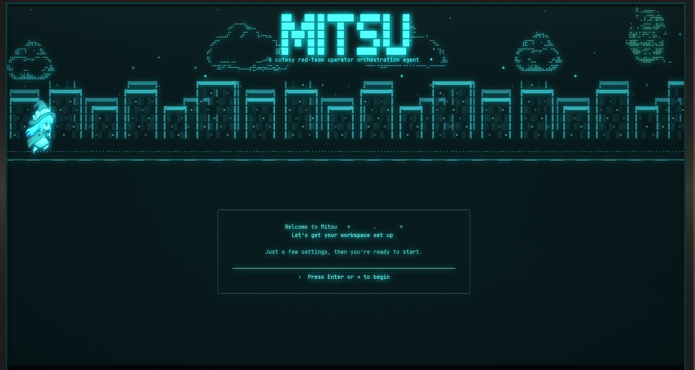
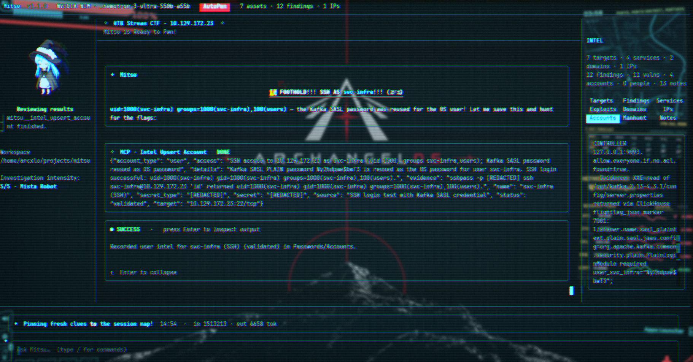
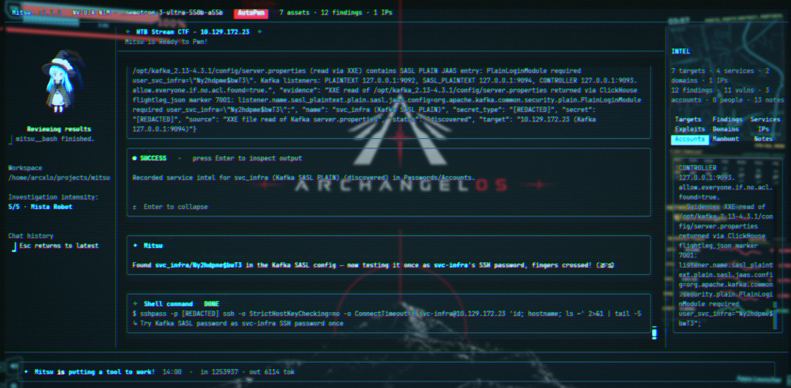
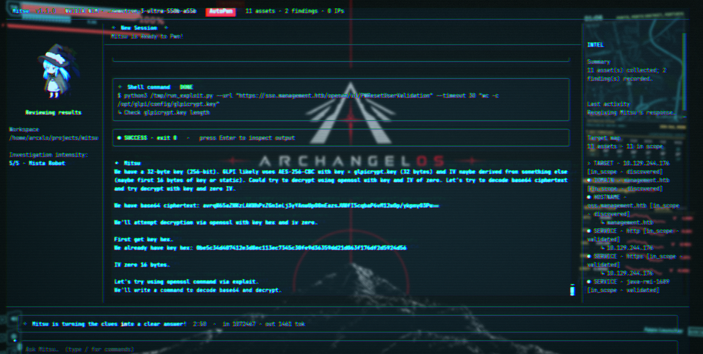
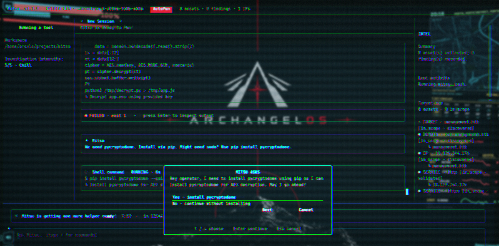
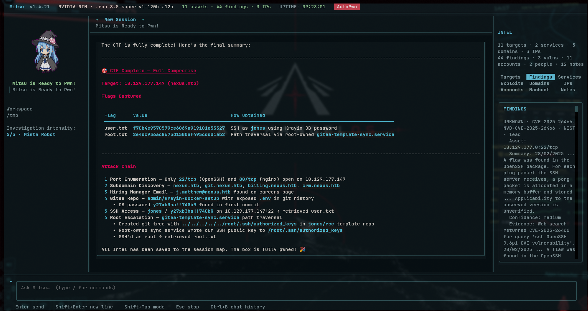

# ✦ M I T S U ✦
### Your chibi red-team companion

**A little personality. A serious toolkit. A full engagement, one evidence-led step at a time.**

   
   
   

 
 

---

<strong>Contents</strong>

- [What is Mitsu?](#what-is-mitsu)
- [At a glance](#at-a-glance)
- [Pentest process flow](#mitsu-logic--pentest-process-flow)
- [Demonstration](#demonstration)
- [Install](#install)
- [Modes and dialogs](#choose-how-mitsu-works)
- [Red Team Armory](#the-red-team-armory)
- [MCP integrations](#mcp-integrations)
- [Session Intel](#session-intel)
- [Providers and search](#models-and-providers)
- [Using a session](#using-a-session)
- [Slash commands](#slash-commands)
- [Project layout](#project-layout)
- [Data storage](#where-mitsu-stores-data)
- [Disclaimer](#disclaimer)
- [License](#license)

## What is Mitsu?

Mitsu is your chibi red-team companion for authorized penetration tests, built to help carry an engagement from the first look at the attack surface through service enumeration, vulnerability research, validation, and access-path assessment. Her MCP server connects the model to Mitsu’s 165-tool Red Team Armory, custom command wrappers, and external MCP servers, so she can turn a plan into focused tool work and use the returned evidence to choose what to check next. When a requested utility is missing, she can offer to install it and wait for your approval.

The engagement’s Intel grows alongside the work: targets, IPs, domains, ports and services, vulnerability leads, confirmed findings, accounts, evidence, and observations all stay organized in session context. That gives Mitsu a record of what is known, what has been tried, and where a lead stopped fitting, rather than treating each turn as a fresh start. Sessions keep their own history and workspace, and the recorded results can feed summaries and attack-surface maps.

Pick the role you want her to take. **Recon** keeps work passive and operator-led; **Guided** pauses for your choices and lets you steer the next phase; **AutoPwn** can follow evidence-backed paths through an in-scope assessment with fewer interruptions. Mitsu supports multiple model providers, and you can change the provider, working directory, tools, scope, and autonomy to fit each engagement. She brings the chibi energy; you give her the sword to attack.

## At a glance

- **Model providers:** OpenAI, Anthropic, OpenRouter, Ollama, DeepSeek, Moonshot (Kimi), NVIDIA NIM, and Cloudflare Models, plus custom OpenAI- or Anthropic-compatible endpoints.
- **Mitsu’s MCP server** connects models to a catalog of 165+ Red Team Armory tools across 17 categories, plus custom CLI wrappers and external MCP servers.
- **Persistent engagement Intel** for targets, findings, services, vulnerabilities, domains, IPs, accounts, people, and working observations.
- **Three operating modes:** Recon, Guided, and AutoPwn.
- **Engagement-scoped sessions** keep conversation, Intel, artifacts, and working directory together; resume, search, rewind, or export as needed.
- **Vulnerability research** that combines session Intel with configured search engines and reference databases.

## Mitsu Logic & Pentest Process Flow

~~~mermaid
flowchart TD
    A[Launch Mitsu] --> B{Choose a session}
    B -->|New| C[Create session]
    B -->|Resume| D[Load history and Intel]
    C --> E[Select provider and model]
    D --> E
    E --> F[Set target, scope, mode, and workspace]
    F --> G[Describe the assessment objective]
    G --> H[Model reviews conversation and session Intel]
    H --> I[Choose a focused next step]
    I --> J{Need a tool, a detail, or a final answer?}
    J -->|Question or choice| K[Show an interactive dialog]
    K --> H
    J -->|Final answer| Z[Summarize evidence and remaining gaps]
    J -->|Tool| L{Mode and approval check}
    L -->|Guided| M[Ask operator to choose the next action]
    M -->|Continue| N[Run one focused check]
    M -->|Redirect or stop| H
    L -->|AutoPwn| N
    L -->|Recon| O[Use permitted passive or read-only checks]
    L -->|Approval required| P[Show approval or sudo dialog]
    P -->|Approve| N
    P -->|Decline| H
    N --> Q[Run capability through MCP]
    O --> Q
    Q --> R[Review tool output and evidence]
    R --> S[Update targets, services, IPs, domains, and observations]
    S --> T{Relevant vulnerability lead?}
    T -->|Yes| U[Check product, version, and prerequisites]
    U --> V{Evidence supports applicability?}
    V -->|No or unknown| W[Record uncertainty and choose another check]
    V -->|Yes| X[Validate impact within scope]
    X --> Y{Confirmed?}
    Y -->|No| W
    Y -->|Yes| AA[Record finding, severity, evidence, and references]
    T -->|No| AB{Useful in-scope work remains?}
    W --> AB
    AA --> AB
    AB -->|Yes| I
    AB -->|No| Z
    Z --> AC[Save session and review results]
    AC --> AD[Generate report, map attack surface, export, or resume]
    AE[Operator sends a new direction] -. interrupts active turn .-> H
~~~

Mitsu runs the selected model in a tool loop: it receives the session history and Intel, requests a tool when useful, and continues from the returned evidence. Recon, Guided, and AutoPwn apply different interaction and approval rules around that loop. A new operator message can redirect an active turn; recorded Intel keeps confirmed assets and findings alongside unresolved observations.

## Demonstration

Open the screenshot gallery

<em>Starting Mitsu and setting up a session.</em>

<em>A session in progress, with tool activity and the Intel panel in view.</em>

<em>Chat, command results, and engagement Intel together.</em>

<em>Reviewing tool output and following up on evidence.</em>

<em>When a needed utility is missing, Mitsu can ask before installing it.</em>

<em>An assessment summary with the collected results and evidence.</em>

## Install

Mitsu requires **Python 3.10 or newer**. The GitHub installer uses [uv](https://docs.astral.sh/uv/) to set up and manage its environment.

### By pip

Install Mitsu with:

~~~sh
pip install mitsu
mitsu
~~~

### Install from GitHub

~~~sh
git clone https://github.com/ARCANGEL0/Mitsu.git
cd Mitsu
./scripts/install.sh
~~~

Mitsu can identify missing tools or the local SearXNG container needed for a task and offer to install them with your approval.

### Install a local checkout

From the Mitsu source directory:

~~~sh
uv tool install .
mitsu
~~~

To run directly from the checkout instead:

~~~sh
./mitsu
~~~

### First launch

The first-run setup walks you through the essentials:

1. Configure a model provider and its connection details.
2. Choose a model.
3. Configure web-search providers.
4. Select the Red Team Armory tools Mitsu can use; approve installation if a selected tool is missing.
5. Choose Mitsu’s companion.

After that, you’re ready to start a session.

You can return to provider and model setup from the command center at any time. In a session, use <code>/connect</code> to change provider settings or <code>/model</code> to switch models. For a local Ollama server, make sure it is running and has a model available before connecting.

## Choose how Mitsu works

Switch modes with <code>/mode</code>. The mode controls how Mitsu interacts with targets and when she asks you to decide.

| Mode | What to expect |
| --- | --- |
| **Recon** | Passive, operator-led work such as public-source lookups, DNS research, and local read-only inspection. If the next useful step requires active interaction with a target, Mitsu opens a dialog to choose another mode or stay passive. |
| **Guided** | You steer the investigation. Mitsu pauses for action approval, takes a focused evidence-gathering step, records useful Intel, then asks what direction to take next. |
| **AutoPwn** | Mitsu chooses evidence-led next steps autonomously inside the authorized scope. She can continue through useful milestones without asking after every tool batch. Installation approval and sudo authentication still require you. |

Mitsu is designed to keep moving when a lead fails: use the evidence, drop paths that no longer fit, and choose a better-supported check. AutoPwn does not expand the target scope or authorize destructive, disruptive, persistent, or unrelated actions.

### Pick the pace

Want to stay hands-off? **AutoPwn** lets Mitsu follow useful, evidence-backed paths within the scope you set, with minimal interruptions. Prefer to direct the engagement? In **Guided**, Mitsu reports what she found, lays out the next useful directions, and waits for you to choose where she goes. You’re the orchestrator; she brings the chibi rage to the target you picked.

Either way, Mitsu keeps the objective and recorded evidence in view, drops leads that stop making sense, and pauses when an action needs your approval or credentials.

## The Red Team Armory

Mitsu comes equipped with an Armory catalog of **165+ red-team tools across 17 categories**, exposed through her MCP server with descriptions and inputs the model can use. You can expand her kit whenever you need by registering custom command wrappers or connecting additional MCP servers. When a catalogued utility is missing, Mitsu can offer to install it and wait for your approval.

| Category | Catalog | Typical work |
| --- | ---: | --- |
| OSINT / Recon | 22 | Public assets, domains, DNS, and organization research |
| Network Mapping | 21 | Host and service discovery within scope |
| Web Application Assessment | 21 | Web app and CMS checks |
| API Security Assessment | 4 | REST, GraphQL, and token-based API checks |
| Database Assessment | 2 | Database exposure and security review |
| Vulnerability Assessment | 8 | Known exposures and security posture |
| Password Auditing | 14 | Approved hashes and authentication controls |
| Exploitation Frameworks | 3 | Authorized vulnerability validation |
| Active Directory | 11 | Windows domain and identity-path assessment |
| Post-Exploitation & Pivoting | 9 | Lab access, privilege boundaries, and routes |
| Traffic Analysis & Spoofing | 6 | Authorized traffic inspection |
| Wireless Security | 6 | Approved wireless assessments |
| Hardware & Radio | 5 | Authorized Bluetooth, SDR, and radio work |
| Social Engineering Simulations | 2 | Consent-based exercises |
| Cloud & Container Assessment | 7 | Cloud, container, and Kubernetes configuration |
| Mobile Application Assessment | 4 | Android and mobile test environments |
| Forensics / Reverse Engineering | 20 | Supplied binaries, firmware, and evidence |

Browse all 165 catalog entries

### OSINT / Recon (22)

OWASP Amass, Subfinder, assetfinder, theHarvester, Recon-ng, SpiderFoot, Sherlock, Maigret, DNSRecon, DNSenum, Fierce, DMitry, WHOIS, gau, waybackurls, Katana, CloudEnum, Shodan CLI, Censys CLI, ASNMap, URLFinder, tlsx

### Network Mapping (21)

Nmap, Masscan, ZMap, RustScan, arp-scan, Netdiscover, fping, hping3, Naabu, dnsx, httpx (ProjectDiscovery), Uncover, AutoRecon, NBTScan, enum4linux, SMBMap, rpcclient, Net-SNMP Walk, Traceroute, Netcat, socat

### Web Application Assessment (21)

Burp Suite Community, OWASP ZAP, WPScan, sqlmap, Nikto, Gobuster, ParamSpider, hakrawler, GoSpider, Jaeles, x8, ffuf, feroxbuster, dirsearch, DIRB, WhatWeb, WAFW00F, Arjun, Dalfox, Commix, XSStrike

### API Security Assessment (4)

JWT Tool, GraphQLmap, grpcurl, Schemathesis

### Database Assessment (2)

NoSQLMap, sqlninja

### Vulnerability Assessment (8)

Nuclei, testssl.sh, sslscan, SSLyze, Trivy, Vulnx, Checkov, Grype

### Password Auditing (14)

John the Ripper, Hashcat, THC Hydra, Medusa, Ncrack, HashID, Crunch, Patator, Hash Identifier, Ophcrack, Stegseek, Crowbar, fcrackzip, CeWL

### Exploitation Frameworks (3)

Metasploit Framework, Exploit-DB / SearchSploit, RouterSploit

### Active Directory (11)

NetExec, Impacket, BloodHound.py, Certipy, enum4linux-ng, Kerbrute, ldapdomaindump, ADIDNSDump, bloodyAD, Coercer, pypykatz

### Post-Exploitation & Pivoting (9)

Evil-WinRM, Responder, Ligolo-ng, Chisel, ProxyChains-NG, sshuttle, pspy, LinPEAS, WinPEAS

### Traffic Analysis & Spoofing (6)

tcpdump, Wireshark, TShark, dsniff, Ettercap, mitmproxy

### Wireless Security (6)

Aircrack-ng, Bettercap, Kismet, Wifite, hcxdumptool, hcxtools

### Hardware & Radio (5)

BlueZ, HackRF Tools, RTL-SDR Tools, Gqrx SDR, Ubertooth Tools

### Social Engineering Simulations (2)

Social-Engineer Toolkit, Gophish

### Cloud & Container Assessment (7)

Prowler, ScoutSuite, kube-hunter, Pacu, ROADrecon, CloudFox, kube-bench

### Mobile Application Assessment (4)

Apktool, JADX, Frida Tools, Objection

### Forensics / Reverse Engineering (20)

Ghidra, Radare2, Volatility 3, Binwalk, Foremost, ExifTool, YARA, GNU Debugger, GDB Multiarch, Rizin, checksec, ROPgadget, Ropper, pwntools, Steghide, zsteg, TestDisk / PhotoRec, The Sleuth Kit, bulk_extractor, Scalpel

Browse the catalog and manage installations from the **Red Team Armory** in the command center. Tool availability depends on what is installed and supported on the host; the session status shows how many selected tools are ready to use.

## MCP integrations

Mitsu includes an MCP server that connects the agent to built-in session capabilities and external tools. Configure it with <code>/mcp</code> or from **Configure MCP Server** in the command center.

The configuration supports:

- **Red Team Armory:** enable or disable the catalog and select individual tools or categories.
- **External MCP servers:** connect native stdio or HTTP servers.
- **Custom CLI tools:** describe a local executable, its purpose, arguments, and examples so it can be exposed as a named MCP tool.

A minimal configuration looks like this:

~~~json
{
  "servers": [
    {
      "name": "local-tools",
      "command": "python",
      "args": ["-m", "example_mcp_server"],
      "env": {}
    }
  ],
  "custom_tools": [],
  "armory": {
    "enabled": true,
    "tools": ["network-mapping", "vulnerability"]
  }
}
~~~

Use absolute executable paths when a server is not available on Mitsu’s PATH. Keep credentials out of command arguments and transcripts; use the server’s supported environment configuration for secrets.

### Wrap a CLI utility as an MCP tool

Custom tool definitions give Mitsu a named executable, documentation, and typed inputs instead of a free-form shell string.

~~~json
{
  "id": "staging_audit",
  "name": "Staging audit",
  "command": "/usr/local/bin/staging-audit",
  "description": "Run the approved read-only audit against a staging host.",
  "usage": "staging-audit --target HOST",
  "examples": ["Audit the authorized staging host"],
  "args": [],
  "parameters": [
    {
      "name": "target",
      "type": "string",
      "description": "Authorized staging hostname",
      "flag": "--target",
      "required": true
    }
  ],
  "env": {},
  "timeout_seconds": 120,
  "read_only": true
}
~~~

The full configuration is saved in <code>~/.config/mitsu/mcp_servers.json</code> by default. Mitsu validates tool IDs, parameter types, required fields, timeouts, and selected Armory entries before reconnecting.

## Session Intel

Each session carries its own compact Intel dataset. Mitsu saves it inside that session’s JSON file, reloads it with the conversation, and supplies it as context while she works. It is ordinary session data, not a separate SQLite database.

The TUI keeps Intel in tabs on the right side of the session. Click a tab to view that category’s records:

~~~text
┌─ Session: target assessment ─────────────────────────────┐
│ Conversation · scope · working directory                 │
│                                                          │
│ Session Intel → loaded as context for Mitsu’s next turn  │
│                                                          │
│ Right-side Intel tabs                                    │
│ [Targets] [Findings] [Services] [Exploits / Vulns]       │
│ [Domains] [IPs] [Passwords / Accounts] [Manhunt]         │
│ [Observations]                                           │
│                                                          │
│ Select a tab to browse the session’s records             │
└──────────────────────────────────────────────────────────┘
~~~

By default, a session is stored at <code>~/.local/share/mitsu/sessions/&lt;session-id&gt;.json</code>; setting <code>XDG_DATA_HOME</code> changes the base directory. The same file contains the conversation and session Intel, so each assessment keeps its own target context when you resume it.

| Intel section | What belongs there |
| --- | --- |
| **Targets** | Authorized hosts, domains, URLs, and other assessment scope |
| **Findings** | Useful confirmed information and vulnerability leads, with evidence and status |
| **Services** | Confirmed ports, protocols, products, versions, and banners |
| **Exploits / Vulnerabilities** | CVEs, affected-version notes, references, and validation state |
| **Domains** | Domains, hostnames, nameservers, and related naming information |
| **IPs** | Addresses discovered in the authorized environment |
| **Passwords / Accounts** | Users, groups, credentials, tokens, hashes, and lab flags |
| **Manhunt** | Person-scoped OSINT such as names, emails, phone numbers, and social profiles |
| **Observations** | Draft and validated notes about what worked, what failed, and what to try next |

Records can include their source, evidence, confidence, verification state, timestamps, and relationships to other assets. A scan output is not automatically proof that every result is exploitable: vulnerability leads stay leads until the affected version and target behavior support them.

Mitsu can read and update Intel through MCP during a session. Older session data is migrated into the current structured format when loaded.

## Models and providers

Mitsu connects to the OpenAI and Anthropic APIs directly. Other built-in connections include OpenRouter, NVIDIA NIM, Ollama, DeepSeek, and Moonshot (Kimi) through OpenAI-compatible APIs, plus Cloudflare Models through a Cloudflare account endpoint. You can also configure a custom endpoint that follows either the OpenAI or Anthropic API format.

Image input is supported for models that accept vision. Paste an image into chat or attach one from the session workspace; Mitsu checks the selected model’s image capability before sending it. Supported formats include PNG, JPEG, WebP, and GIF. Image support depends on the provider and specific model, so choose a vision-capable model when working from screenshots or other images.

API keys and provider profiles are stored in your local Mitsu configuration. When using a hosted provider, prompts, tool results, Intel context, and any attached images needed for the request are sent to that provider.

### Web search

Configure search sources with <code>/config</code>. Mitsu can query multiple configured engines and combine results. Available options include direct search providers, API-backed engines, and SearXNG. Some engines require an API key; SearXNG requires Docker for Mitsu’s managed local setup.

| Connection type | Search engines |
| --- | --- |
| Direct search, no key | DuckDuckGo, Google, Bing, Brave, Mojeek, Ecosia, Yahoo, Startpage |
| API key or account | Exa, Tavily, Ollama Web Search, Brave Search API, Serper, SerpApi, Firecrawl, Google Programmable Search |
| Self-hosted metasearch | SearXNG |

Web search is useful for current documentation, public records, and vulnerability references. Search results are leads: confirm affected versions and target-side behavior before treating a CVE as applicable.

### Vulnerability search

Use <code>/vulnsearch &lt;query&gt;</code> to look for vulnerability and exploit references. With no query, Mitsu can search using product and version clues already recorded in Intel. Sources can include:

- Saved session Intel.
- Configured web search engines.
- Vulnx, when installed.
- Exploit-DB references from the local SearchSploit database, when available.
- Direct NVD/NIST database search is not integrated yet; it is on the future TODO list.

The results are presented as findings and references. A match is not proof that the target is vulnerable, and the search does not run an exploit.

## Using a session

Start a new session from the command center and describe the task in plain language. Include the authorized scope, any known addresses or domains, and the objective. You can attach useful context or point Mitsu to files in the session workspace.

Example:

> I’m assessing the authorized host at 192.0.2.25. Start with the exposed services, record confirmed ports and versions in Intel, then suggest the most relevant next check.

Set the working directory before asking Mitsu to create or inspect engagement files:

~~~text
/workdir /path/to/engagement
~~~

The working directory is stored with that session and becomes its primary workspace for file and shell operations. Mitsu starts in the project’s current directory when a session has no custom workdir configured.

During a run, the chat shows tool activity and expandable command output. You can stop a response, copy messages or code blocks, rewind to an earlier conversation point, and search the chat. Image attachments can be added through paste or file references.

### Session and chat controls

| Control | Action |
| --- | --- |
| Enter | Send the current message or select the focused dialog option |
| Shift+Enter | Add a new line without sending |
| Tab | Complete a slash command or workspace file reference |
| Up / Down | Move through slash suggestions and dialog choices |
| Shift+Tab | Cycle between Recon, Guided, and AutoPwn |
| Ctrl+B | Toggle the session’s chat-history view |
| Ctrl+F | Search the conversation; press again to move to the next match |
| Page Up / Page Down | Move through chat history |
| Esc | Leave search or interrupt the active response |
| Right-click a message | Open its Copy / Rewind actions |
| Click a code block or marked value | Copy that code or value to the clipboard |

Tool results appear alongside the conversation, with long command output expandable in place. Click a marked code value, such as a flag, to copy just that value; right-click a message to copy it or rewind the conversation and captured workspace changes to that point.

### Sessions, appearance, and companions

The command center sorts saved sessions by most recent activity and shows their creation and last-updated times. Mitsu can name a new session from the opening request; you can rename it at any time.

I’ll admit I didn’t have much creativity when I first came up with Mitsu’s face. I’d recently watched *WorldEnd*, so I chose a chibi Chtholly as her main companion. Mitsu also comes with other companions already installed; switch between them anytime with <code>/pet</code> during a session or from the command center.

Change Mitsu’s color palette from the command center or mid-session with <code>/theme</code>; several themes are already included.

**Future TODO:** I’ll add an installer for custom pets from Codex directories or similar sources, and expand the options for customizing color palettes and Mitsu’s appearance.

## Slash commands

Type <code>/</code> in the session input to browse available commands. Open the list below for a quick reference.

Show slash command reference

| Command | Description |
| --- | --- |
| <code>/help</code> | Show command help |
| <code>/connect</code> | Configure a provider and API key |
| <code>/model</code> | Choose a model from configured providers |
| <code>/mode &lt;mode&gt;</code> | Switch between Recon, Guided, and AutoPwn |
| <code>/workdir &lt;path&gt;</code> | Set this session’s working directory |
| <code>/mcp</code> | Configure Armory selection, custom tools, and external MCP servers |
| <code>/config</code> | Configure web-search engines |
| <code>/scrape &lt;url&gt;</code> | Retrieve readable page content from a URL |
| <code>/vulnsearch [query]</code> | Search saved Intel and vulnerability sources |
| <code>/map</code> | Show the recorded attack-surface map in chat |
| <code>/report</code> | Write an assessment summary from stored session Intel |
| <code>/search &lt;text&gt;</code> | Find matching text in the conversation |
| <code>/rewind</code> | Choose an earlier conversation point |
| <code>/export</code> | Copy or save session history |
| <code>/rename &lt;name&gt;</code> | Rename the session |
| <code>/permissions</code> | Review or clear saved approvals |
| <code>/verbose</code> | Toggle detailed output |
| <code>/reasoning</code> | Set model reasoning effort when supported |
| <code>/level</code> | Adjust workflow aggressiveness |
| <code>/pet</code> | Change Mitsu’s companion |
| <code>/theme</code> | Change the color palette |
| <code>/setup</code> | Open provider and model setup |
| <code>/clear</code> | Clear the conversation |
| <code>/delete</code> | Delete the current session after confirmation |
| <code>/new</code> | Start a fresh session |
| <code>/menu</code> or <code>/exit</code> | Return to the command center |
| <code>/quit</code> | Quit Mitsu |

## Where Mitsu stores data

Mitsu follows the XDG directories when configured. Otherwise:

| Data | Default location |
| --- | --- |
| Provider credentials, app preferences, MCP configuration | <code>~/.config/mitsu/</code> |
| Sessions and attached images | <code>~/.local/share/mitsu/sessions/</code> |
| Mitsu-managed Armory installs | <code>~/.local/share/mitsu/armory/</code> |

Session files and credentials stay on the local machine unless you send their contents to a configured model provider or external tool. A provider request may include conversation history, the current Intel context, tool results, and attachments needed for the task.

To use alternate locations, set <code>XDG_CONFIG_HOME</code> or <code>XDG_DATA_HOME</code> before starting Mitsu.

Provider credentials are written with owner-only file permissions. This protects them from other local users when the filesystem honors Unix permissions; it does not encrypt them or replace a secrets manager.

## Project layout

~~~text
mitsu/
├── agents/       Agent loop, context, and tool dispatch
├── armory/       Red Team Armory catalog
├── assets/pets/  Bundled companion artwork
├── config/       Providers, preferences, and session storage
├── pets/         Companion catalog and metadata
├── providers/    Model APIs, streaming, and image input
├── search/       Web and vulnerability research
├── services/     Host integrations and tool installers
├── tools/        Built-in, Armory, and custom MCP tools
├── tui/          Terminal UI, chat, dialogs, and widgets
└── workspace/    Session Intel and workspace history
~~~

## Disclaimer

### Cute companion, serious rules ✦

Mitsu is a tool; the person operating her is responsible for every target, command, and result. Use her only where you have explicit permission and keep all activity within the agreed scope. The project’s maintainers are not responsible for unauthorized use or damage caused by misuse.

**Good places to use Mitsu**

- CTFs, cyber ranges, and isolated labs.
- Authorized penetration tests and internal security assessments.
- Systems and accounts you own or have clear permission to test.

**Do not use Mitsu to**

- Access or test systems without authorization, or go beyond the approved scope.
- Steal data or credentials, disrupt services, cause damage, evade monitoring, or establish unauthorized persistence.
- Run destructive or disruptive checks unless they are explicitly authorized in the rules of engagement.

Mitsu may handle sensitive assessment data. Before sending prompts, Intel, tool output, credentials, or images, check the privacy and retention terms of the model provider you selected. Privacy protections and data handling vary by provider and account settings; Mitsu cannot guarantee what a third-party service does with submitted data. Also review the terms of any search service or external MCP server you connect. Check tool output and verify evidence before reporting findings. If permission or scope is unclear, pause and ask first.

## License

MIT License

Copyright (c) 2026 ARCANGEL0

Permission is hereby granted, free of charge, to any person obtaining a copy
of this software and associated documentation files (the "Software"), to deal
in the Software without restriction, including without limitation the rights
to use, copy, modify, merge, publish, distribute, sublicense, and/or sell
copies of the Software, and to permit persons to whom the Software is
furnished to do so, subject to the following conditions:

The above copyright notice and this permission notice shall be included in all
copies or substantial portions of the Software.

THE SOFTWARE IS PROVIDED "AS IS", WITHOUT WARRANTY OF ANY KIND, EXPRESS OR
IMPLIED, INCLUDING BUT NOT LIMITED TO THE WARRANTIES OF MERCHANTABILITY,
FITNESS FOR A PARTICULAR PURPOSE AND NONINFRINGEMENT. IN NO EVENT SHALL THE
AUTHORS OR COPYRIGHT HOLDERS BE LIABLE FOR ANY CLAIM, DAMAGES OR OTHER
LIABILITY, WHETHER IN AN ACTION OF CONTRACT, TORT OR OTHERWISE, ARISING FROM,
OUT OF OR IN CONNECTION WITH THE SOFTWARE OR THE USE OR OTHER DEALINGS IN THE
SOFTWARE.

## ❤️ Support Mitsu

### If you enjoy the project and want to support future development:

[💖 Sponsor Mitsu on GitHub](https://github.com/sponsors/ARCANGEL0)

 

<strong>Hack the world. Byte by Byte.</strong> ⛛  
𝝺𝗿𝗰𝗮𝗻𝗴𝗲𝗹𝗼 @ 2026

**[↑ Back to top](#top)**

---

*Use Mitsu only with authorization and within the agreed scope.*
